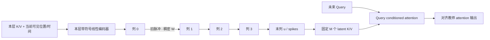

# 当前实现架构

每个 Transformer 层对应独立二维片，层间没有连接。W 的形状为 `[L,C-1,Nout,Nin]`，`einsum` 不混合层维。列间只从旧脉冲读取；所有列同步计算，再统一生成新状态。仅事件首微步注入外部输入，后续微步首列电流严格为零；相邻事件不插入 flush。

动力学：`pre=exp(-dt/tau)*u+I`，`s=H(pre-threshold)`，`u_next=pre-threshold*s`。tau 和 threshold 通过对数参数化保持为正；硬脉冲前向、fast-sigmoid 代理反向。S 个微步总时长保持为 `event_duration`，dt 为该时长除以 S。零输入等待仍进行完全相同的动力学和时间推进。

持久态是不可变 dataclass：u/spikes `[B,L,C,N]` FP32、time `[B,L]` FP32、events int64、valid bool。初始状态/重置通过 `initial_state(B)` 创建；`detach()` 截断训练图；导出包含配置和版本，恢复检查 shape/dtype 与 head 契约。本轮没有 stream 管理器，独立流必须使用独立状态。训练无隐式全局状态，每条新序列从零状态开始。

K/V `[B,L,Hkv,Dh]` 经每层线性层编码，附加 `sin(position/16)` 与 `sin(time/16)` 两项元数据；不做 ReLU 截断。编码位置来自事件索引，不含事件标签、未来 Query 或答案。合成 attention 使用未旋转 K/Q；本轮无真实 RoPE。latent keys 直接在 query space 定义。

读取 Q `[B,Hq,Nq,Dh]`，输出同形状。Hq 必须能被 Hkv 整除；编码器联合压缩所有 KV heads，readout 输出各 Query head，不持久复制 K/V。每个读取位置有独立参数；全列输入维度更大，实际参数量随结果记录。空状态输出零。`read` 不推进时间，不写入缓存。探针恢复预定地址的 Value：唯一事件场景恢复强 Key 标记事件的 Value，其他场景恢复末 token 的 Value，不提供 Query。

合成 KV 存储与延迟读取测试 教师持有短历史以计算监督。学生只持有五个固定形状状态 tensor；历史序列和预测日志位于实验层。推理长流检查逐事件生成并丢弃输入，没有输入列表。训练目标是原始历史 attention（remote），干扰延迟后同时评估包含干扰 token 的 full-history attention；后者未作为训练目标，不能混淆二者。

状态字节数按实际 tensor dtype 计算；spikes 当前为 FP32，不按 bool 估算。静态 encoder/W/tau/threshold/readers/probes 与 buffer 单列。CPU RSS 包括 Python、PyTorch、教师、训练和 checkpoint，GPU peak 包含整轮训练，均不声称是学生独立部署峰值。时间统计区分 batch 写入每事件与 batch 读取；GPU 计时同步。长流延迟报告前 256 事件的 p50/p95，无硬件节能推论。

EMA 对照使用线性级联 `u_next=decay*u+(1-decay)*drive`，传播来源是旧 EMA，去掉阈值与 reset；第二缓冲保存 EMA 副本。它与 LIF 的字节相同但存在冗余，并非最优内存实现。断链通过不可训练 mask 切断首对连接，梯度也无法恢复该连接；冻结对照只冻结 W。

读取器的逐步计算、张量形状、latent KV 与 Value 探针的区别见 [LIF implementation and readout](readout.md)。当前 LIF 使用原生 PyTorch 与自定义代理梯度，没有使用 SpikingJelly。
