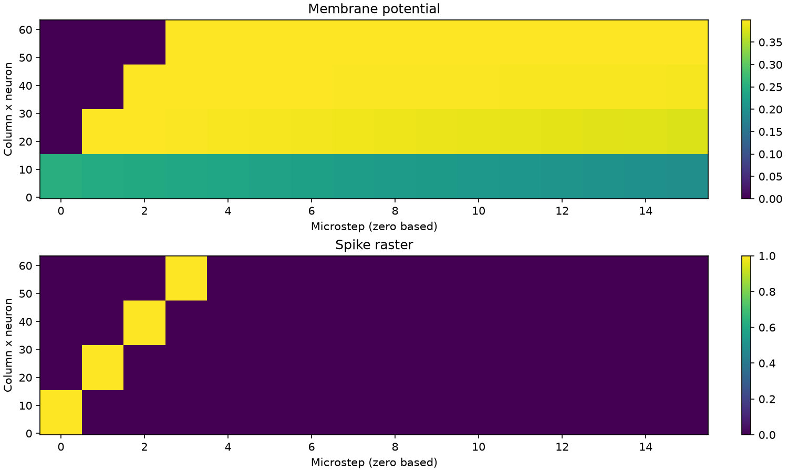
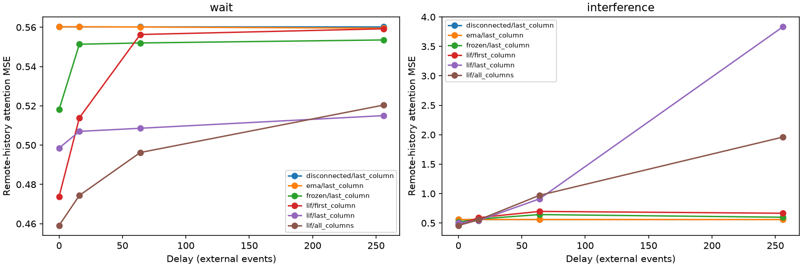

# BioCache 初始验证实测报告

## 测试状态

| 测试内容 | 结果 |
|---|---|
| 拓扑与传播测试 | passed；首次发放微步 [1, 2, 3, 4] |
| 合成 KV 存储与延迟读取测试 | 代码与实验完成；整体判据未通过，非零延迟 3/24 条件通过 |
| 真实 VLM 逐层 trace 收集 | 未执行 |
| 真实逐层蒸馏测试 | 未执行 |
| 真实模型替换测试 | 未执行 |

完整建立指南的 P0/P1 仅完成本轮实验基础模块，未完成完整框架验收；P2/P3 未完成。

## 环境与实际命令

环境：`/data/user25101366/.conda/envs/biocache`，Python 3.11.18，PyTorch 2.7.1+cu128，CUDA runtime 12.8，SpikingJelly 0.0.0.0.14。使用官方 ParametricLIFNode 与 ATan，torch 后端。GPU 为 A100，CUDA 前后向测试通过；本轮三种子实验使用 CPU、单线程。

```bash
conda activate /data/user25101366/.conda/envs/biocache
python -m pytest -q
python experiments/lif_kv_feasibility/run_propagation.py --output outputs/propagation_spikingjelly
python experiments/lif_kv_feasibility/run_synthetic.py --output outputs/synthetic_spikingjelly
python experiments/lif_kv_feasibility/build_report.py --propagation outputs/propagation_spikingjelly --synthetic outputs/synthetic_spikingjelly
```

测试结果：20 passed in 1.97s（包含 CUDA，未跳过）；依赖 `pip check` 通过。原始输出保留在项目 outputs；精简证据包含逐种子完整 JSON、CSV、配置、版本记录和图像。checkpoint 留在 outputs。

## 传播



受控权重下，C=4 时末列在第4微步首次发放；软重置、断链、片间隔离检查通过。这只证明动力学实现正确。

## 独立验证集训练变化

下面将每个种子在四种数据、两种等待模式、延迟0/16的末列 attention MSE 平均；初始和训练后用相同测试序列。

| Seed | 初始 MSE | 训练后 MSE | 相对下降 |
|---|---:|---:|---:|
| 11 | 0.630188 | 0.529303 | 16.0% |
| 22 | 0.640265 | 0.479994 | 25.0% |
| 33 | 0.640571 | 0.525995 | 17.9% |

encoder、W、tau、threshold、readout 梯度范数逐参数记录于 JSON；LIF 三种子均有有限非零梯度。checkpoint 恢复后，当前输出、下一事件状态及输出逐值一致。

## 末列保持判据

预登记标准：三个种子的独立测试均值，末列 MSE 比清零与打乱状态两对照均下降至少20%；对照误差接近零时用绝对容差1e-6。按数据/延迟/干扰分别判断，不把平均改善当作全部通过。

| 数据 | 模式 | 延迟 | MSE 均值±样本标准差 | 清零 MSE | 打乱 MSE |
|---|---|---:|---:|---:|---:|
| similar_keys | wait | 16 | 0.075118±0.006375 | 0.126591 | 0.157107 |
| similar_keys | wait | 64 | 0.076064±0.006034 | 0.126591 | 0.154182 |
| similar_keys | wait | 256 | 0.080728±0.004791 | 0.126591 | 0.145225 |

上表只列通过的非零延迟条件，其他条件均未通过。完整通过/失败列表见 [summary.csv](results/summary.csv) 和 [summary.json](results/synthetic/summary.json)。只有3个种子，未做统计显著性推断，不能声称一般历史 KV 存储成功。



曲线包含各读取位置及 EMA、断链、冻结 W；是四种数据的平均，仅用于诊断，验收仍逐条件判断。测试延迟64/256超过训练延迟0/4/16；长延迟失败含外推限制。干扰输入下未达到预设判据。

教师全历史注意力、仅原始远期历史注意力分别报告；训练只监督后者。精确窗口对照的容量为8个token，等待时保留原历史；有干扰时保留最后至多8个干扰token。四类数据的探针误差、清零/打乱探针误差与首列/全列读取误差均在逐种子JSON，不用非零膜电位代替信息保持。

## 资源

| 事件数 | 持久状态字节 | 完整 KV 字节 | 缓存比 | 新增静态模块+状态字节 |
|---:|---:|---:|---:|---:|
| 1000 | 2061 | 64000 | 31.05 | 509053 |
| 10000 | 2061 | 640000 | 310.53 | 509053 |

静态参数 126,745 个、506,980 字节，其中列间 W 12,288 个；另有 12 字节连接 mask。这里包括三个诊断读出器和三个探针，均未从统计中隐藏。spikes 为 FP32，状态按实际存储计算；持续流状态固定五个 tensor，推理无 autograd 图、无历史 KV 容器。

单样本 CPU 写入 p50=0.797 ms、p95=0.882 ms（前256事件）。全进程峰值 RSS=809,304,064 字节，包含教师/训练/框架，不是学生独立部署峰值；本轮 CPU 运行不报告 GPU 训练峰值。每批次写入、读取计时在逐种子 JSON。

缓存有界性通过；静态模块使短历史总开销高于完整 KV。未测真实 VLM 端到端峰值、端侧延迟或能耗。

## 后端变更

本报告结果已使用 SpikingJelly 后端重新运行。旧原生 PyTorch / 自定义代理梯度的历史结果保留在 Git 历史与旧 outputs，不作为本报告当前指标。连续时间常数映射为官方 PLIF 衰减参数，阈值通过归一化保留可训练性；没有重写充电、发放、软重置或代理反向算子。checkpoint 状态版本升为2，旧版本明确拒绝导入。

## 限制与下一步

目前末列在低复杂度平均 Value 读取场景可保留部分信息；随机/唯一事件和持续干扰条件不足。下一步先固定预算，检查连接权重与阈值、容量、训练延迟分布和 Query-conditioned readout，再决定是否进入真实 trace 阶段。当前结果不支持长期精确记忆或真实视频问答可用性的结论。

EMA 对照使用相同分配字节、第二缓冲为冗余副本。全列读出参数更多：{'first_column': 12416, 'last_column': 12416, 'all_columns': 36992}；探针参数：{'first_column': 8776, 'last_column': 8776, 'all_columns': 33352}。本轮没有正负双通道、固定总神经元容量的 C/N/S 扫描、真实浅中深层误差或在线任务结果。
